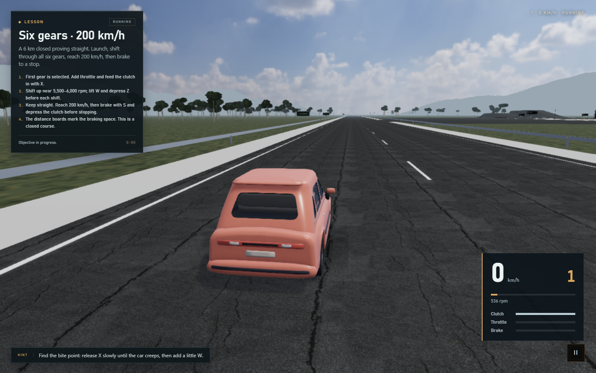

# Bite Point

[](https://github.com/richie-rich90454/bite-point/actions/workflows/ci.yml) [](LICENSE)

**Feel the bite. Nail the shift.** An open-source six-speed manual driving simulator with a 250 Hz vehicle model, clutch heat and wear, H-pattern shifting, an endless procedural highway and no artificial top-speed ceiling.

[Report a bug](https://github.com/richie-rich90454/bite-point/issues/new/choose) · [Contribute](CONTRIBUTING.md) · [Physics](docs/physics.md) · [Validation](docs/validation.md)

A browser-based manual-transmission driving simulator built around a custom, testable vehicle simulation. Drive one reference compact car across a training lot, two hill grades and a closed high-speed proving straight. Babylon.js renders the scene; TypeScript and Vite run the application; the powertrain, tires and chassis are simulated independently of the renderer.



## Requirements

- Node.js 24 (the CI reference runtime)
- pnpm 12 (the repository uses a pnpm lockfile)

## Quick start

```bash
pnpm install
pnpm dev
```

Open the URL printed by Vite. Production and verification commands:

```bash
pnpm build       # type-check and production build
pnpm preview     # serve the production build
pnpm typecheck   # strict TypeScript check
pnpm test        # Vitest unit, integration and numerical tests
pnpm lint        # ESLint
pnpm format:check # oxfmt formatting check
pnpm assets:check # verify CC0 and third-party asset provenance
pnpm test:e2e    # Playwright browser smoke test (install Chromium once)
pnpm exec playwright install chromium
```

## What is implemented

- Custom 250 Hz fixed-step vehicle simulation: engine, clutch, six-speed H-pattern gearbox, synchronizers, reverse lockout, final drive, open differential, FWD/RWD/AWD drivetrains, wheels, brakes, tires, steering, quasi-static suspension loads and chassis motion.
- Engine torque from a shape-preserving torque curve, starter and ignition, idle control with anti-stall assistance, fuel cut, engine braking and stall transitions.
- Clutch capacity from pedal position, clamp force, temperature and wear; slip torque, bounded coupling, slip energy, heating and cooling.
- H-pattern shifter state machine driven by `Enter` and the arrow keys. No numpad and no simultaneous arrow combinations are required. Gears are not engaged until the lever is released.
- Optional automatic clutch handles launches and gear changes without the clutch keys. Stability assist damps high-speed slides, and the steering angle falls with speed for a more predictable car.
- Keyboard bindings by physical key code, remapping screen, input tester, focus-loss safety, tab-hidden pause, gamepad/wheel support through the Gamepad API.
- Photographic HDR sky and image-based lighting, plus scanned PBR asphalt with normal and packed occlusion/roughness maps. CC0 assets from Poly Haven are bundled locally.
- Four-sample MSAA on High quality, FXAA at every quality level, device-pixel-aware render resolution, 16× road texture filtering and stabilized cascaded shadows on supported hardware. Authored vehicle textures are preserved.
- Selectable endless maps: City Center, Industrial District, Coastal Highway, Alpine Pass, Forest Run, Tunnel Run, Bridge Crossing, Summit, Endless Straight, Endless Curves and World Tour. Every map generates deterministically from its seed and streams 160 m chunks with road, markings, guardrails, terrain and theme content. The six-kilometre proving straight remains available as a legacy lesson.
- Real generated city blocks with building footprints, varied heights, window grids, roofs, entrances, sidewalks, curbs, streetlights and signage. Industrial, tunnel, bridge, coast, forest, alpine and summit themes add warehouses, containers, chimneys, tunnels, bridge decks, water, beaches, trees, rocks and snow.
- Twelve manual-transmission cars across five tiers with naturally aspirated, turbo, hybrid and electric power, FWD, RWD and AWD drivetrains, measured 0-100 km/h times and distinct engine sounds. The car and map selectors live on the start screen and in the pause menu.
- Deterministic world seed, O(1) road tracking, bounded chunk caches and a streaming budget designed to hold 60 fps at 1080p on a mid-tier discrete GPU.
- Cockpit, hood and exterior cameras, a dedicated exterior speed, gear, rpm and shift display with live pedals, mouse look with pointer lock, dashboard instruments, pedals, steering wheel, gear lever, wipers, headlights and a day-lit training environment.
- Eight CC0 Grab3D car bodies with animated wheel pivots and a detailed cockpit interior. Each car uses its own authored body and colour: compact, sedan, hatchback, muscle car, rally car, sports car, electric car and coupe. The performance reference revs to 9,000 rpm, runs 0-100 km/h in benchmark time and reaches beyond 500 km/h on the endless straight. An optional 500 km/h limiter is off by default.
- Real CC0 asphalt, grass, gravel, rock, concrete and metal texture sets with 2K sources, local KTX2 runtime decoding and JPEG fallback.
- Noto Sans-only interface with a redesigned settings surface, sentence-case labels, per-section resets, units, HUD scale, colorblind and reduced-motion support.
- Web Audio engine, intake, exhaust, turbo, wind, tire, starter, gearbox and stall sounds. Engine profiles for naturally aspirated, turbo, hybrid and electric cars are synthesised; no unlicensed samples are bundled.
- Launch control: hold the brake and throttle in first gear to hold the engine at the bite point, then release the brake to launch.
- Lessons for moving off, hill starts, upshifts, braking, reverse parking, a 0-100 km/h sprint and a launch-to-200-to-stop challenge; an instructor that explains stalls, rollback, clutch slip, lugging and over-revving from measured simulation state.
- Telemetry recording at 20 Hz, a live graph, JSON export and replay of the last 20 seconds.
- Pause menu with lessons, settings, rebinding, input testing and diagnostics (frame rate, physics cost, catch-up, clutch state, wheel loads and surface).

## Default controls

| Key                 | Action                                                         |
| ------------------- | -------------------------------------------------------------- |
| `W` / `S`           | Accelerator / brake                                            |
| `A` / `D`           | Steer left / right                                             |
| `Z` / `X`           | Depress / release the clutch                                   |
| `Enter`             | Grab or release the gear lever                                 |
| Arrow keys          | Move the lever through the current gate / neutral corridor     |
| `N` / `R`           | Request neutral / reverse (reverse remains subject to lockout) |
| `Space`             | Handbrake while held                                           |
| `I` / `K`           | Ignition toggle / starter while held                           |
| `C` / `Home`        | Cycle camera / recenter view                                   |
| `F` / `G`           | Headlights / wipers                                            |
| `Tab` / `F1` / `F2` | Telemetry / help / instructor                                  |
| `Esc`               | Cancel lever interaction, close a dialog or pause              |
| Hold `Backspace`    | Recover a stopped vehicle to the start of the session          |
| `1`–`6`             | Quick-select gears only when enabled in Settings               |

All bindings can be changed in **Pause → Controls**. The H-pattern is the default because it teaches the actual gate layout: `1` is left-forward, `2` left-rear, `3` centre-forward, `4` centre-rear, `5` right-forward and `6` right-rear. Neutral is the horizontal corridor.

## Driving technique

1. Press `I` for ignition and hold `K` until the engine catches. Keep the clutch depressed with `Z`.
2. Press `Enter` to grab the lever, move left and up with the arrow keys, then `Enter` again to select first.
3. Release `X` slowly. At the bite point the car begins to creep; add a little `W`, hold the bite briefly, then release fully.
4. To upshift, press `Z`, move the lever through neutral to the next gate, release the lever, then release `X`.
5. On a hill, hold the foot brake or handbrake, bring the clutch to its bite point, and release the brake as the drivetrain takes the load. There is no hidden anti-rollback aid.

## Project layout

```
src/
  app/            application lifecycle, frame loop, settings and UI wiring
  simulation/     engine, clutch, gearbox, driveline, tires, suspension, chassis, road, telemetry
  input/          physical-key bindings, keyboard and gamepad adapters, calibration
  presentation/   Babylon scene, car and cockpit, dashboard canvas, cameras
  audio/          Web Audio synthesis
  scenarios/      lesson definitions and progress checks
  instructor/     telemetry-driven coaching
  settings/       persisted user settings
  ui/             HUD, pause menu, help, telemetry and input tester
  data/           validated reference vehicle JSON
docs/             architecture, physics, vehicle data and validation notes
tests/            unit, integration, numerical and browser tests
```

Architecture and physics details are in [docs/architecture.md](docs/architecture.md), [docs/physics.md](docs/physics.md), [docs/vehicle-data.md](docs/vehicle-data.md) and [docs/validation.md](docs/validation.md).

## Vehicle data and realism

The bundled roster uses eight CC0 Grab3D car bodies: 1990s compact, 1990s sedan, hatchback, muscle car, rally car, 1990s sports car, electric car and coupe. Each car keeps its authored body texture and colour, with animated wheel pivots and a shared detailed cockpit. The top-tier Bite Point performance car uses a 9,000 rpm turbocharged four-cylinder, an all-wheel-drive drivetrain, approximately 700 Nm, a simulated 0-100 km/h time near three seconds and a drag-limited top speed beyond 500 km/h. The lower tiers cover a 1.6 commuter, a 2.0 city sedan, a turbo hot hatch, a V8 muscle car, a rally special, sports and track coupes, a supercar, a V10 GT, a hybrid hypercar and an electric hypercar. The models are original CC0 assets and contain no manufacturer logos or copyrighted branding. Model sources and SHA-256 hashes are recorded in `src/assets/assets.json` and `src/assets/LICENSE-grab3d-models.txt`. The performance figures are gameplay calibration, not production-car measurements. Every major parameter group carries a provenance tag in `src/data/reference-compact.json` (`measured`, `documented`, `estimated` or `unvalidated`). The configuration validator rejects invalid units, missing fields, non-monotonic ratios and impossible clamp geometry at startup with a readable error instead of starting a broken simulation.

The current tire, suspension and road-contact models are deliberately transparent approximations. They are calibratable and tested, but they are not a substitute for measured vehicle data. Known approximations and release gaps are listed in the physics and validation documents.

## Testing

The test suite covers torque-curve interpolation, idle and stall behavior, clutch slip and heat, H-pattern movement, synchronizers and reverse lockout, driveline ratios, tire limits, suspension and steering, simulation-clock catch-up, configuration validation, telemetry buffers, keyboard safety and rebinding, deterministic simulation, hill rollback, hill holding, launches, braking, reverse and wet-surface stopping. Numerical tests repeat launches at 1/120, 1/250 and 1/500 second steps and check for finite state and bounded spread. A Playwright smoke test boots the production build, starts a session, selects first, launches and shifts to second.

Run `pnpm test` for the deterministic tests, including a 0-100 km/h benchmark, a top-speed run beyond 500 km/h on the endless straight, high-speed finite-state checks and endless-world streaming, and `pnpm test:e2e` after installing Chromium. Validation results and current gaps are recorded in [docs/validation.md](docs/validation.md). Asset and algorithm citations are in [docs/references.md](docs/references.md).

## Performance

The physics loop is fixed at 1/250 s with bounded catch-up (up to 120 steps per frame, with adaptive render quality when the frame rate falls). Rendering interpolation prevents render-frame timing from changing the model. Physics paths avoid per-step allocation; telemetry samples are allocated only at 20 Hz. The application streams local CC0 assets: a 1.16 MB car GLB, a 5.45 MB photographic HDR sky and about 2.27 MB of scanned road maps. The HDR environment is converted into a 512-pixel cubemap for lighting and reflections. Babylon.js core is imported through granular modules and dedicated mesh builders rather than the monolithic entry point. The diagnostics panel reports frame rate, physics cost, catch-up and clutch state. Overload warnings appear only after sustained overload rather than for a single slow frame.

## Assets and licenses

Project code is licensed under [MIT](LICENSE). The bundled hatchback model and its textures are CC0; see [the asset source and license](src/assets/LICENSE-hatchback.txt). The photographic HDR sky and scanned asphalt maps are CC0; see [environment asset credits](src/assets/LICENSE-environment.md). The terrain, prop and road texture sets are CC0 and recorded in [src/assets/assets.json](src/assets/assets.json) with per-file SHA-256 checks. The local KTX2 decoder is Apache-2.0; see [src/assets/LICENSE-ktx2.md](src/assets/LICENSE-ktx2.md). The remaining environment geometry, sounds and UI artwork are generated locally from code. No third-party audio recordings are bundled. Runtime dependencies are open source: Babylon.js and its KTX2 decoder (Apache-2.0), Vite and Vitest (MIT), TypeScript (Apache-2.0), Playwright (Apache-2.0), ESLint (MIT), oxfmt (MIT) and jsdom (MIT). Review their license files in `node_modules` when distributing a build.

## Current limitations

- Training-lot props and buildings are decorative and not collidable. The road contact is an analytic height field; a BVH-backed collision system, traffic, weather, nighttime lighting and additional vehicles are future work.
- Suspension is a quasi-static spring/damper load model used for wheel loads and ride presentation; the chassis is a planar rigid body with load transfer, not a full 6-DOF multibody model.
- Tire forces use a smooth tanh slip curve with a friction ellipse; tire temperature and wear are not yet modelled.
- Audio is parametric synthesis, not reference-vehicle recordings.
- Reference-vehicle calibration against measured time-series data is pending; treat aggressive handling and absolute acceleration claims as approximations until a measurement report replaces the estimated provenance tags.

## Graphics settings

High quality combines up to 4× MSAA (where WebGL2 hardware supports it), FXAA and native display density capped at 2×. Render scale can raise resolution further. Medium and Low retain FXAA; sustained overload lowers resolution and disables expensive effects to preserve driving responsiveness. Quality recovers one step after 12 seconds above 55 FPS. Open **Pause → Settings** to adjust quality, shadows and render scale. No motion blur obscures the road or instruments.

## Community

Start with [contributing](CONTRIBUTING.md), follow the [community guidelines](CODE_OF_CONDUCT.md), and report vulnerabilities according to [SECURITY.md](SECURITY.md). Bug and feature templates collect useful reproduction details; pull requests run lint, simulation tests, production compilation and Chromium driving checks.

Suggested repository topics: `driving-simulator`, `manual-transmission`, `vehicle-physics`, `babylonjs`, `typescript`, `webgl`, `racing`, `driver-training`, `open-source`.

The project is a learning and simulation tool. Its approximations are documented; it has not been certified for driver training or validated against a measured production vehicle. Photorealism, full collision geometry and measured handling calibration remain active development goals.
